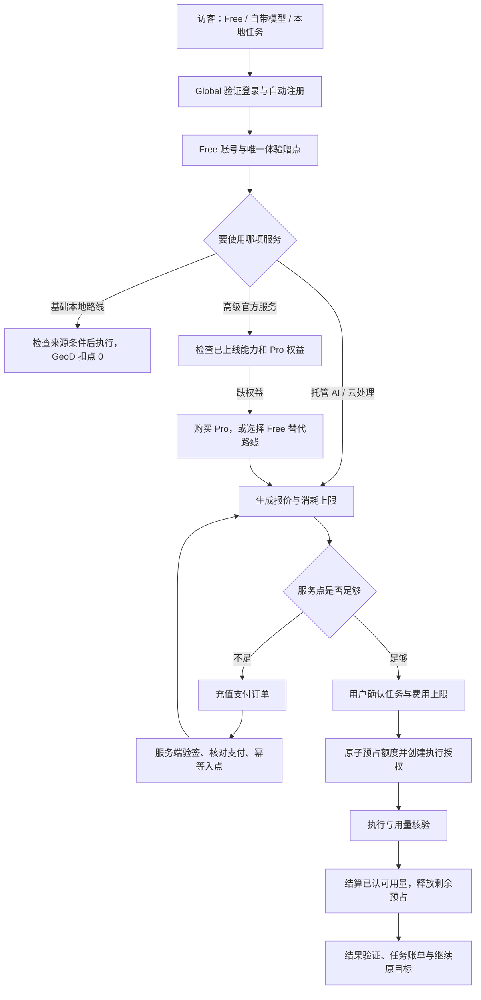

# GeoD Global — Free / Pro、服务点与交易闭环设计

日期：2026-10-09。状态：**完整设计草案，未启用收费**。当前基线为 v0.2.0-rc.4 / `0803b0b`。用户已确认“基础图源免费、高级接入服务 Pro”的方向，并进一步明确：**当前只做平台聚合，暂不接商业影像采购**。本文的价格、额度、供应商分档与支付渠道仍是建议，不能作为已上架商品。

同日实现更新：已按此边界新增独立官方聚合服务、本地 beta 权益/账本、真实目录监测、桌面与 Agent 确认入口，以及 Stripe 测试适配器。具体已实现与尚未上线的范围以[官方服务实现记录](../docs/official-aggregation-service.md)为准。下文仍是完整目标设计，不意味着已完成真实商户、续费、云处理或收费验收。

## 1. 产品定义和收费对象

GeoD Global 提供从自然语言需求到可验证二维地理数据成果的工作台。用户购买 Pro，获得高级来源的官方聚合维护、托管自动化和交付服务；购买服务点，支付实际使用的托管 AI / 云处理成本。商业平台若以后接入，只使用用户在供应商处已有的有效授权，不代下单、不转售影像、不代收供应商影像费用。

四项账户状态独立：

| 对象 | 解决什么 | 不意味着什么 |
|---|---|---|
| Global 账号 | 身份、订单、权益、账单与设备会话 | 不自动取得模型或 NASA / Copernicus 权限 |
| Pro 权益 | 使用已上线的高级官方服务 | 不代表全部高级图源都已接入，不包含任意商业影像 |
| 服务点 | 支付托管 AI、官方云处理 / 中转等已报价服务 | 余额充足不自动开通 Pro；本地文件不会因点数不足被锁住 |
| 用户自带的数据供应商授权 | 对具体产品、区域、用途、期限的访问许可 | 不由 GeoD 会员或充值产生，不通过我们采购 |

销售对象应写成“高级聚合与自动化服务”，不能将开放影像描述为我们独占的付费数据。Sentinel / Landsat 的开放性质与用户自带的供应商许可分别记录，来源见第 15 节。

当前代码为 GPL-3.0-only。GPL 允许收费分发，也保留接收者的修改与再分发权。**纯本地开源程序里的会员开关不能作为可靠收费边界**：官方托管服务必须在服务端验证权益；现有公开本地代码和旧发行版的权利不变。独立商业组件若未来需要不同许可，另行核对权属与第三方依赖，不能通过这份设计静默更换许可证。

### 1.1 开源后如何保护收费服务

我们能保护的是**自己运营的服务资源和账户权益**，不能保证他人无法修改 GPL 本地程序，也不能禁止合规使用公开数据。把 `isPro`、余额或许可证检查放在开源客户端，都只能改善官方 UI；修改代码即可绕过纯本地限制。代码签名、混淆、加密配置或离线许可证不能改变这一边界。

推荐“开源桌面 + 官方聚合服务 Pro”：社区客户端和基础连接保留；官方服务实际承担统一目录索引、跨平台查询编排、来源状态维护、定时监测、托管 Agent / 可选云处理等有持续运营价值的功能。每个请求由服务器验证用户、有效权益、资源归属和预算，并产生可核对用量。私钥、供应商服务凭据、充值/结算权限只在受控后端，不能放进安装包或 Git。

服务器必须**真正执行有价值的服务**。如果它只返回“允许使用”的标志、下发一段普通 URL 或给本地方案盖签名章，而全部高级处理和来源查询仍已开源在本机，修改后的客户端依然可以自行完成；这不是可靠收费权益。

即使服务端代码以后也开源，用户自建一套服务仍不等于拥有我们运营实例上的账户、计算资源、API 凭据或配额。允许社区自建，与对官方托管实例收费可以并存。不能因此声称没人能做竞品；竞争优势是接入维护、索引质量、真实交付与省去部署成本。

分开的保护目标：防止未授权使用官方资源靠服务端身份/ACL/权益检查；防止重复扣费靠幂等账本；控制账户共享靠并发/速率/预算和会话撤销；防止伪装官方发行靠签名与品牌识别；许可合规按对应许可证处理。没有一项能承诺百分之百防止共享或复刻。

对只有本地适配器价值、没有官方持续服务的能力，可收费提供维护支持或官方发行便利，但不能将其作为不可绕过的本地权限售卖。若以后希望新增专有高级模块，需要另外选择 open-core/商业许可、核对代码权属与 GPL 组合边界；现阶段不改变许可证。实证对照见[开源商业化调研](../docs/research/open-source-commercialization-2026-10-09.md)。

## 2. 两个会员档位，加服务点充值

| 项目 | Guest / Free | Pro |
|---|---|---|
| 浏览二维数据源目录、接入状态和来源说明 | 可用 | 可用 |
| 地点 / 行政区查询、地图预览、任务确认 | 已有基础流程保留 | 同基础流程，增加已上线高级服务方案 |
| 稳定公开基础源、本地已实现的下载 / 裁剪 / 拼接 / 科学读取 | 现有能力保留，不按本地字节或次数扣点 | 同 Free |
| 自带模型 API Key 的基础 Agent | 保留，模型费用由供应商收取 | 保留 |
| 高级官方服务包 | 可预览功能与支持范围；可选择 Free 替代路线 | 已上线包可用，依然检查数据源许可 / 账号 |
| 托管 Agent / 云处理 | 登录后可使用赠送 / 购买服务点 | 可使用月度赠送 / 购买服务点 |
| 多地区监测、长时序编排、官方托管排程、跨源质量策略 | 服务上线后显示 Pro | 服务上线后可用；算力和托管 AI 仍按报价计点 |
| 成果与历史、原值 / 来源核验、导出自己的文件 | 保留 | 到期后仍保留 |
| 支持服务 | 文档、社区和问题反馈 | 明确范围的优先支持，不承诺尚无能力值守的 SLA |

**独立商品 A：服务点充值包。** Free 也能购买，只支付已允许使用的托管服务；不会绕过 Pro 或数据许可。

**平台聚合边界。** 不设商业影像采购商品、采购订单、代购报价、供应商采购回调或影像采购退款功能。用户已有授权的平台可以作为后续连接候选，上游费用、许可与购买由用户和供应商直接处理。我们的订阅和服务点账单只记录 GeoD 自己提供的服务。

会员介绍不写“无限 AI”“无限云处理”“全球高清全部解锁”。数据目录数包含产品、协议、本地格式，不能按卫星数量宣传。

## 3. 图源分档：产品、接入服务、上线状态分别展示

不是按分辨率简单划分，也不把“需要注册供应商账号”直接等同于付费。

| 档案类别 | 示例 | 建议服务包装 | 当前边界 |
|---|---|---|---|
| 基础公开源 | Earth Search Sentinel-2 L2A、PC Landsat、Copernicus DEM、NASA GIBS、OSM | Free 基础路线 | 以当前各产品验收范围为准 |
| 公共协议 / 自有文件 | STAC、COG URL、WMS/WMTS、WCS、WFS、ArcGIS 公共服务、本地二维格式 | 基础连接和既有操作 Free | 协议支持不等于每个第三方服务均有导出许可 |
| 专业公开产品 | Sentinel-1 RTC、NAIP、MODIS 科学层 / QA、复杂专题与时序产品 | 基础已实现本地功能保留；新增托管专业自动化为 Pro 候选 | 当前本地可用不等于 Pro 托管服务已上线；NAIP 不是全球覆盖 |
| 复杂原始产品 | NASA HLS / VIIRS / SRTM 原件、Copernicus SAFE、科学 HDF / NetCDF | 授权编排、原件准备、匹配 QA 和验证交付的高级服务包 | 当前受保护原件仍有实际账号验收门禁；买 Pro 不能解除门禁 |
| 申请、专题或限制许可来源 | ESA TPM、灾害开放影像、FABDEM 等 | 逐产品许可复核；符合条件后才选 Free / Pro 服务 | “能下载”“公开链接”都不能代替商业使用与服务分发许可 |
| 商业平台聚合 | 吉林一号等未来供应商连接候选 | 只聚合目录与用户已有授权；上游费用由用户直接承担 | 当前未接入；不做采购，不授予上游权限 |
| 综合门户 / 样例 | 国内科学数据门户、JAXA 门户、SAR 免费样例 | 先拆到具体数据集再分档 | 不把整个门户或样例当完整下载源售卖 |

全量 85 项已单独映射到 [拟议权益目录](commercial/source-entitlements.proposed.json) 和 [分档表](commercial/source-entitlements.proposed.csv)。映射不是许可审查，也不改变运行时接入可用性。商业平台候选说明已移除订单表述，原来的 31 ready / 6 auth / 48 planned 状态保留。

每张来源卡片最多显示三条不同含义的信息：

1. 接入：**可用 / 需供应商授权 / 待接入 / 暂停**。
2. GeoD 服务：**Free 基础 / Pro 高级服务 / 自带授权的平台聚合 / 待定**。
3. 使用条件：**开放 / 自带账号 / 需申请 / 订单许可 / 待核验**。

例如 `Copernicus SAFE：原件待验收 · Pro 服务候选 · 需 Copernicus 账号`，按钮为“查看接入进度”，不能是“付费立即下载”。对于已经有 Free 原件路线的产品，“升级 Pro”不能替代“使用基础路线”。

服务器准入顺序：能力已发布 → 操作级许可允许 → 供应商授权就绪 → Global 会话有效（若服务需要）→ Pro 服务权益有效（若需要）→ 报价授权与额度充足。不同失败返回不同原因，不把授权过期、无覆盖、未接入误报成余额不足。

## 4. 定价初案和成本约束

以下是可讨论的海外 USD 实验价，不是现行价格，也不是竞品价格引用。数字保存在 [报价草案](commercial/catalog.proposed.json)，`purchasable=false`。

| 商品 | 建议价 | 包含什么 |
|---|---|---|
| Free | $0 | 基础路线、自带模型；验证账号后一次性 100 服务点体验额度 |
| Pro 月度 | $19 / 月 | 已上线 Pro 服务权益；每个账期 300 服务点 |
| Pro 年度 | $149 / 年 | 12 个月权益；按月发放 300 点，不一次发 3,600 点 |
| 服务点包 | $10 / 1,000 点；$30 / 3,000 点 | 额外已购服务点；初期不做大额折扣 |
| 商业平台连接 | 不设影像采购商品 | 仅在用户已有授权和接入许可允许时聚合；上游费用不计入 GeoD 账单 |

1 点对应 **$0.01 的标价服务使用额度**，用于报价换算，不是现金钱包，不转账 / 提现。已购点退款按原交易和实际消费审核，不能简单按剩余点“兑现金”。报价含税与否、支付支持国家、最低支付额、退款规则必须在可购买前按实际经营主体与渠道补齐；不能偷偷在付款后加费用。

试用赠点只有验证账号后发放一次，不按安装次数赠送。不给赠点要求绑卡，不在试用结束自动收费。设备/IP 风险信号不能自动合并账号或阻止正常家庭共享网络；需服务端限速、赠点预算与人工复核。

成本表必须分别采样：模型供应商实付、官方云处理、官方中转流量、存储、PSP/MoR 与退款成本、维护支持。**用户直连上游下载到本地的流量不算我们的云传输成本**。每个模型 / 服务由版本化价目表定价，不按一句对话或一景统一扣点。

月度毛利评估 = 实收会员 / 服务收入 − 支付与退款成本 − 托管可变成本 − 支持成本分摊。税费另列，上游供应商自行收取的费用不进入我们的收入与退款账本。价格只有在代表性任务的真实成本、尾部成本和商户条件核实后才进入公开购买页。年费每月收入分摊与月度赠点负债同时测算，不用年费现金流掩盖持续成本。

## 5. 服务点规则

| 点数桶 | 产生方式 | 建议有效期 | 到期 / 退款 |
|---|---|---|---|
| 体验赠点 | 验证账号后的唯一赠送事件 | 30 天 | 不可提现、不可转赠；到期前提示 |
| Pro 账期赠点 | 有效订阅的月度唯一 grant | 至下一月账期，不累计 | 取消自动续费后，本期权益和点数至本期结束 |
| 已购点 | 已核验支付订单 | 初案不设到期 | 不随 Pro 到期清零；原订单退款规则需审核确认 |

优先使用最早到期赠点，再用已购点；订单回滚必须回到原桶，不能将赠点释放成已购点。UI 分开显示“会员剩余点”“体验点”“已购点”“本次预占”，而非一个无法解释的总余额。

内部点数用整数 `creditMicros`（1 点 = 1,000,000 微点），报价和执行只在明确边界舍入；不对每个 token / 每个网络分片向上取整。支付金额用 ISO 币种 + 整数最小货币单位，模型成本使用明确的整数单位。点数不是收入账本，订阅收入、退款、银行结算独立记账。

无负可用余额。额度不足在下一项收费操作开始前暂停，不到流程结束才补欠款。Pro 到期后已购点仍可用于 Free 可用的托管服务，但不能替代 Pro 权益。下载 / 本地成果和历史不因降级消失。

## 6. 注册 → 登录 → 权益 → 充值 → 消耗



### 6.1 注册和登录

复用已部署 Global 邮箱 / Google / GitHub 和桌面 PKCE 协议；商业功能绑定服务端稳定 `user_id`，不绑定邮箱字符串、昵称或设备。现有不同登录方式不会因邮箱相同自动合并；合并账号必须证明两端控制权，并明确迁移订阅、余额和订单。

访客仍可使用已实现基础本地路线；发起托管服务、充值、开通 Pro 时再登录。回调恢复到原任务卡，避免登录后丢失需求。注册 / 恢复、供应商授权和付费引导是不同流程。

### 6.2 购买 Pro / 充值

客户端只提交服务端商品 ID、数量和幂等键。服务端计算金额、币种、税费和渠道，不接受客户端价格。收银台在系统浏览器打开；用户明确确认订单后才进入支付。

`created → pending_payment → paid → fulfilled`，或 `expired / cancelled`；退款另走 `refund_pending → partially_refunded / refunded / refund_failed`，争议另走 `disputed`，不倒写原支付事件。

浏览器支付完成页只用于提示“正在核实”。实际入点 / 开权益以服务端验签、商户与订单绑定、金额/币种、供应商 payment ID 及必要的主动查单为准。事件先持久化后应答，重复 webhook / 查单只履约一次；确认支付成功但履约失败进入重试队列，可在“恢复购买”中补回。

用户界面显示“支付成功，服务点已加入”；经营后台把 PSP 已支付、可结算、已打款、银行已核对分开。付款成功不等于钱已到银行。

同一人重复支付两张不同订单不能自动当重复 webhook 丢掉；分别记录并提供退款 / 合并处理。取消充值或支付失败不影响原任务卡，保留待确认状态，不自动开始下载。

### 6.3 订阅续费和降级

初始购买清楚展示周期、总价、赠点规则、取消入口。未启用自动续费时按期到期；支持的渠道可在用户显式选择后自动续费。续费失败只暂停新 Pro 服务，不删除本地文件，不自动扣充值余额续会员。

月度 / 年度赠点按订阅锚点发放，UTC 存储、本地日期显示。相同 `subscription_id + period_index` 只发一次；年费不是每月重复收款。月转年由服务端提供有有效期的差价报价，不由客户端计算，也不重复赠本月额度。

授权上限内已经接纳的服务允许按执行授权完成，不因中途到期造成无结果收费；新任务和追加操作按当前权益重新检查。退款 / 争议触发新服务暂停、未执行预占释放及人工复核，不破坏已验证本地成果。

### 6.4 任务报价和消耗

固定价的高级交付可以按任务收费；托管 Agent 按已配置模型用量报价；云处理按算子 / 原生像元 / 时间窗 / 数据量计量；官方数据中转按实际中转量计价。每一种计价独立列明，数据开放不等于我们的托管计算免费。

1. **检查并报价**：先检查空间范围、实际覆盖、科学层、授权、服务发布状态和可估计文件；不为“尚未接入 / 无权使用”的服务建立可付款报价。
2. **确认**：复用现有完整任务卡，把收费服务、模型、执行位置、预计用量、费用上限和必要的数据出网范围放进去。支付不是任务执行确认。
3. **预占**：确认有效的报价后，在一个服务端事务中锁定点数桶并创建执行授权；重复提交恢复同一任务，不重复冻结。
4. **执行**：所有官方收费操作走服务端网关 / 计量器；客户端自报 token、时长、字节不能直接记账。超出报价范围先暂停并重新询问。托管 Agent 在每个收费步骤前预留上限，设置输入、最大输出和工具成本边界。
5. **结算**：用量回执关联具体逻辑操作、供应商 request ID、报价版本及验证结果。完成一次逻辑操作后结算；原任务恢复只复用已完成回执。
6. **释放**：取消、失败或进程崩溃释放未用预占。服务已开始但回执缺失时进入对账，不把未知用量当零或随意估算扣费；超过明确对账期限按已约定规则由平台承担无法证实的费用。

收费默认规则：

| 情况 | 用户结算 |
|---|---|
| 基础源直连下载、本地裁剪、自带模型 | GeoD 服务点 0；模型商 / 数据商费用另行说明 |
| 用户正常得到托管 AI 回答、主动停止已完成的 AI 步骤 | 按可核验用量结算，释放后续预算 |
| 高级交付固定价，成果未通过约定验证 | 不收该交付服务费；按卡片规则处理先前独立已完成步骤 |
| 平台故障、内部自动重试、重复供应商调用 | 平台承担额外成本，不重复收用户逻辑操作费 |
| 供应商授权失败、无覆盖、任务未开始 | 不扣下载 / 交付费；已独立完成的托管 AI 用量须事前说明 |
| 用户改区域、日期、波段或换模型 | 原报价失效；释放未执行预占，新卡片重新确认 |
| 用户主动要求再次执行已完成收费操作 | 显示新报价；保留旧账单关联，不伪装成免费内部重试 |

“失败不收费”只能用于标明的交付服务费，不能暗示此前正常完成的托管 AI 或供应商直接收取的费用都退款。任务卡在确认前写明部分结算规则，账单逐项解释；GeoD 不替供应商处理其独立交易。

## 7. 用户参与和 Agent 花费边界

需要用户决定的源、日期、分辨率、云量、覆盖补齐、商业用途与付费路线继续使用选项卡。升级弹层不会中断免费路径；优先显示“继续 Free 方案”“使用我自己的供应商账号”“查看 Pro 方案”。

**托管对话本身也有费用，不能等下载卡片才第一次说明。** 从自带模型切换到“GeoD 托管 AI”时先展示模型单价、会话预算与每轮上限，用户确认后才发起首个模型请求；允许随时改回自己的连接。每轮请求在会话授权内预占并核验结算，界面显示本轮 / 本会话消耗。准备报价、问选项和自然语言回答也受该预算约束，不以“只是生成方案”为由免费假承诺或暗中扣点。单次任务卡只确认尚未执行的收费行项，已结算的准备对话列为历史用量，不再次结算。取消下载不退款正常完成的对话用量，这一点在启用托管 AI 时和任务卡中都明确。

默认每个收费任务必须确认完整卡片。用户明确说“无需再问”时，仅对已设定的区域、源、用途、模型、费用上限和时限有效。系统不能从“重试”“帮我下载”推导无限预算授权。

全自动模式需要用户设置**单任务上限、每日上限、总点数上限、允许模型 / 服务和有效期**；服务端在多个设备 / 目标之间统一扣减。范围更换、首次数据出网、自动续费依然需要对应明确授权，不能被一般任务免询问选项涵盖。所有模式都不提供供应商采购操作。

选择商业平台只查询已允许访问的目录或已授权资产，卡片显示授权主体、用途、期限、可导出范围和上游可能独立产生的费用。遇到需要购买新授权的资产，返回“需在供应商平台取得授权”；不创建采购订单，也不提供代购按钮。

余额不足属于 `awaiting_budget`，Pro 缺失为 `awaiting_entitlement`，供应商授权缺失为 `awaiting_provider_auth`。这几种情况使目标等待用户，并保留已完成步骤；不会报“模型没返回内容”，也不会让 Agent 无限重试。所有代码是拟议新增，不是当前运行时已支持的状态枚举。

## 8. 界面信息架构和关键文案

保持当前 GeoD Global Beautiful UI、蓝色主操作和紧凑卡片；设计不改变登录页地球背景、对话输入框和右侧预览布局。

### 8.1 账号菜单 / 会员与用量

导航底部账号菜单显示 `Free / Pro · 到期日`，入口为“会员与用量”“充值记录”“消费记录”“管理订阅”。未登录只显示“登录以使用托管服务”，不弹收费墙。

“会员与用量”页面顺序：当前档位 / 到期与续费状态 → 当前可用点数及三种桶 / 预占 → Pro 已上线权益 → 免费能力对照 → 最近消费列表。消费列表限制高度、内部滚动，明细可展开；不把几十景文件全部铺开。

### 8.2 升级页

只放 Free / Pro 两张对比卡，周期选择显示年费总价与折算月价，不能只展示低月价掩盖年付总额。Pro 卡片列具体已上线服务包；“待接入”放规划栏，不作为当前购买权益。页面底部独立说明“GeoD 只聚合平台，不采购或转售影像”“自带模型费用由模型供应商收取”。

建议文案：**基础开放数据，免费开始。复杂数据与重复任务，交给 Pro。**

### 8.3 充值页

显示 1,000 / 3,000 点的总价、当前余额、到账后的预期点数、税费 / 最终付款总额、退款规则入口和“不会自动开通 Pro”。按钮为“查看付款订单”，金额由后端返回；支付 pending、失败、核实中、入点成功都保留可恢复入口。

### 8.4 完整任务卡中的费用区

示例 A（已实测的基础路线，不代表收费功能上线）：

```text
曼哈顿最新 Sentinel-2 真彩色，行政区多边形裁剪
Earth Search · Sentinel-2 L2A · 本地执行
数据费用：免费开放数据
GeoD 服务点：0
模型：使用你的连接，费用由模型供应商计算
覆盖与质量：分别展示实际检查结果
[地图预览] [调整方案] [确认执行]
```

示例 B（金额与用量为明确模拟报价）：

```text
高级官方服务 · 多时相质量筛选
Pro 权益：有效          供应商账号：已验证
托管 AI：预计 8 点     云处理：预计 20 点
预计合计：28 点         本次授权上限：40 点
上游来源：开放数据      执行：官方云服务
将上传：范围、处理参数及本次授权的必要数据
按核验用量结算；平台内部重试不重复扣费
[地图预览] [切换本地 Free 路线] [确认执行，最多 40 点]
```

确认后的卡片显示 `预占 40 · 已结算 26 · 释放 14`，不是把预占写成消费。文件列表、任务总大小和处理质量信息仍保留，费用区不能替代完整任务审核。

### 8.5 权益 / 余额异常

| 原因 | 主操作 | 保留的操作 |
|---|---|---|
| Pro 未开通 / 到期 | 查看 Pro 已上线权益 | 切换 Free 路线、查看已下载成果 |
| 点数不足 | 充值 / 降低收费任务范围 | 自带模型、本地处理、取消待执行部分 |
| NASA / Copernicus 会话失效 | 重新连接供应商账号 | 保存需求，不引导充值 |
| 原件尚未验收或产品未接入 | 查看接入进度 | 可用替代来源，不显示支付 CTA |
| 无覆盖 / 质量不满足 | 修改时间、云量或来源的选项卡 | 保留原要求，不静默降低质量 |
| 平台状态未知 / 服务不可达 | 稍后恢复、查订单 | 免费本地工作不受影响 |

## 9. 系统落点与服务边界

当前桌面：`src-tauri/src/identity.rs` 管身份；`agent.rs` 和 Agent 协议执行工具；Rust JobManager 管本地任务。当前官网：`tools/auth_app.py` / `email_auth.py` / `desktop_auth.py` 管独立 Global 身份。**现有 token usage 只能提供用量展示，不能直接当计费账本。**

建议在 Global 账号后端旁新增独立 Billing 域，保持 Global 产品命名空间。初期可在同一 Starlette 部署中注册独立模块，另用 Billing SQLite 数据库及迁移目录；单写者事务和持久工作队列先满足低并发。达到写入冲突 / 结算吞吐阈值后迁到 PostgreSQL，接口语义保持不变。不同数据库间不伪装成原子事务：订阅/点数/订单全部在 Billing 一个事务域内，身份只作为外部稳定主体引用。

| 模块 | 职责 |
|---|---|
| ProductCatalog / Policy | 商品版本、功能 / 图源服务映射、发布与许可门禁 |
| Entitlements | 订阅权益、账期赠点、到期 / 撤销、签名快照 |
| PaymentAdapter | PSP/MoR 收银台、签名 webhook、查单、退款、争议和结算导入 |
| WalletLedger | 点数桶、预占、结算、释放、退款关联与每日对账 |
| Quote / ExecutionAuthority | 固定输入哈希、费用上限、确认记录、幂等执行授权 |
| ManagedGateway / Metering | 服务端模型 / 云服务调用、供应商用量、超时停止、预算上限 |
| RecoveryWorker / Outbox | 支付已付未履约、丢失回执、孤儿预占、周期赠点补发 |
| DesktopBillingClient | 原生认证请求、安全快照、恢复购买与返回任务卡；不含支付密钥 |
| Operations | 商品上下架、服务暂停、成本 / 争议 / 退款、对账与脱敏支持 |

支付渠道优先覆盖海外信用卡及可验证的订阅/退款流程；评估直接 PSP 与 MoR 的经营主体资格、国家、币种、数据产品类别和结算条件后再选择。本文没有批准或开通任何商户，不把国内支付凭据直接复用到 Global。

高级来源的个人供应商凭据优先留在桌面，由用户直连下载。官方托管流程只发送明确授权的必要数据；服务端中转 / 代访问必须逐来源确认协议与许可。无需上传的本地成果不能为了计费而强制上传。

客户端隐藏按钮仅改善体验，不能授权服务器操作。官方付费服务每次在服务端检查当前权益与预算；CLI / MCP、网页与桌面走同一规则。已签名权益快照可短期显示离线状态，但不是离线产生可结算服务或绕过服务器撤销的许可证。

## 10. 拟议对象、接口与幂等性

以下均为设计，当前线上没有这些 Billing 接口。路径使用 `/api/billing/v1`，服务点与模型 Token 字段不得同名。

| 对象 | 最小约束 |
|---|---|
| BillingCustomer | Global user ID、产品命名空间、计价币种、状态；不以邮箱识别主体 |
| ProductVersion | SKU、币种、整数总价、权益、赠点规则、税制/地区与可购买状态 |
| Subscription | 用户、支付订阅引用、状态、起止、续费选项、账期锚点、撤销原因 |
| CreditGrant | 原桶、来源订单 / 账期、原始点数、可用/预占/已用/过期、到期时间 |
| PaymentOrder / Refund | 原商品快照、金额/币种、供应商 ID、可核对支付和履约事件 |
| TaskQuote | 输入哈希、商品/价格/策略版本、模型、行项、上限、执行位置、出网授权、过期时间 |
| UsageReservation | 报价、桶分配、微点上限、账本状态、可核对执行授权与恢复状态 |
| UsageReceipt | 逻辑操作 ID、供应商 request ID、计量单位/值、验证和价格版本；用量来源可追踪 |
| LedgerEntry | 只追加分录、桶、微点整数、业务事件和反向分录关联；不能任意改余额 |
| ProviderEntitlement | 产品、许可版本/用途/期限、主体证明；与 Pro 无替代关系 |

| 接口 | 语义 |
|---|---|
| `GET /catalog` | 当前地区可购买商品、已上线服务和价格版本 |
| `GET /me` / `/ledger` | 权益、分桶余额、预占与分页账单；只给本人 |
| `POST /checkout` | 创建订阅 / 充值支付订单，不接受客户端金额 |
| `GET /orders/{id}` / `POST /restore-purchases` | 核实支付和幂等恢复履约，不凭前端 success 参数 |
| `POST /webhooks/{provider}` | 原始消息验签、事件去重、订单绑定、持久入队 |
| `POST /subscriptions/{id}/cancel` | 设置取消续费；本期权益按约定结束 |
| `POST /quotes` | 服务端重新检查并生成不可篡改的有效期报价 |
| `POST /quotes/{id}/accept` | 校验输入/价格/确认与余额，原子预占并接纳执行 |
| `GET /executions/{id}` / `POST /executions/{id}/cancel` | 状态、结算与安全取消；恢复不新扣费 |
| `POST /refund-requests` | 原交易与已消费核对；真实退款由后台授权操作 |

实际用量提交只允许内部网关 / 受信服务身份；不能提供任意客户端 `POST /consume` 扣点接口。账单/错误响应不含支付私钥、模型 key、供应商访问令牌或完整敏感签名 URL。

至少建立唯一约束：供应商事件 ID；`provider + payment_id`；商品订单履约 ID；`subscription + period_index`；用户与报价接纳幂等键；执行与逻辑操作结算 ID。并发接纳用事务原子判断可用额度，不能先读取后异步扣。

预占过期不能盲目释放正在执行的资源：执行租约 / 心跳到期后先取消或核对受信执行器，进入 recovery，再按已核验回执结算和释放。恢复 worker 必须可重复执行，不能因一次宕机造成重复入点或重复收费。报价更新会改变内容哈希并废止原确认，不能静默用新价结算旧任务。

退款和争议以反向分录追溯原交易；已消费部分按原订单规则处理，不对其他点数桶“随便减余额”。对账异常暂停相关收费服务，基础本地能力继续运行。账本回滚靠补偿事件，不删除历史分录。

## 11. 数据保留、账号退出和运营控制

删除账号前清楚列出未结束的订阅、未结算执行、余额与可退款订单；处理续费取消、预占释放 / 核对、退款请求及财务保留策略。账号服务的现有级联删除不能直接删除商业账本。必要保留的财务事件去标识化、限制访问和设置经实际政策确定的期限；不以“注销”为由删除核对依据或不告知用户清零。

支持下载自己的交易 / 消费记录；账号锁定或 Pro 到期不会阻止访问自己的本地文件。支付风控冻结仅作用于相关付费服务，错误分类明确且提供人工处理入口。禁止管理员无原因手改余额；赠点 / 调账都有权限、理由、审批或复核和审计记录。

经营后台需要：商户 / 收款渠道状态、商品暂停开关、服务 / 模型最大花费、Free 赠点日预算、异常重复支付、已付未履约、用量缺失、预占滞留、供应商限流、退款 / 争议与银行结算差异。服务暂停后不得继续卖无法履约的 Pro 包或原件产品。

## 12. 分阶段落地，不缩减最终交易闭环

| 工作包 | 范围 | 必需退出证据 |
|---|---|---|
| B0 — 规则与成本 | 本文、85 项服务分档、逐操作许可、真实任务成本采样、商户可行性 | 可购买服务逐个有权益价值、验收与成本记录；价格仍可调整 |
| B1 — 权益与账本 | Global 主体映射、服务目录、订阅/点数桶/预占/结算/释放、原生只读账户页 | 并发、断网、重复、恢复、降级与账本不变量通过；全为测试额度 |
| B2 — 收银台闭环 | PSP/MoR 沙箱订单、回调/查单、恢复购买、部分退款、争议、独立结算状态 | 沙箱支付到入点/开权益、重复回调和恢复通过；真人受控支付/退款另留凭证 |
| B3 — 真实 Pro 服务 | 至少明确一个有新增价值的高级官方服务包，托管执行/计量/验证、用户自带授权 | 实际数据和独立成果验收；报价上限与实际成本一致；失败释放；不能仅有标识 |
| B4 — Agent 集成 | 选项卡、费用完整任务卡、缺权益/预算暂停、登录和充值后恢复、全自动预算 | 桌面/CLI/MCP同等服务门禁；不绕过确认，不重复消费 |
| B5 — 收费上线与运营 | 最终价格与条款、可购买地区/渠道、通知、支持、退款、续费、成本告警、备份恢复 | 用户完成注册→Pro/充值→执行→账单→取消/退款；财务与系统记录逐项核对 |

现在仅完成 B0 的设计材料与当前目录映射，真实成本采样、商户资格和新增 Pro 服务都尚未完成。B1 可先在测试额度环境开发，但 B3 的可交付服务和 B5 的交易验收之前不对用户售卖空 Pro。团队权限、共享项目与企业采购保留后续规划，不混进首个个人 Pro 商品。

## 13. 必须通过的验收场景

1. Guest 用自带模型完成 Free 下载 / 裁剪，不创建 GeoD 付费订单。
2. 验证账号一次赠点；换设备 / 重装 / 重放事件不重新发点；不同合法用户不被误合并。
3. Free 买服务点不获得 Pro；Pro 点数用完不锁已有本地成果；Pro 到期不清已购点。
4. Pro 也无法使用未发布原件、越权供应商账户、禁用商业用途或无覆盖的数据。
5. 篡改商品金额 / 币种 / 回调成功参数不能入点；未认证、跨用户查询订单拒绝。
6. 支付成功后宕机、webhook 重复或乱序、恢复购买只发一次点 / 权益；不同真实支付均保留。
7. 同一余额同时接纳多个目标 / 设备时，原子预占不超余额；每日上限也跨设备统一计算。
8. 预占 40、实际 26、释放 14 后各原桶和流水相符；报价变动或范围变动必须重新确认。
9. 内部网络重试、任务恢复和重复回执不重复结算；用户主动重跑使用新报价。
10. 缺失用量进入对账；未知不计为零、不任意估算；孤儿预占恢复不与执行器竞争扣费。
11. 任务失败区分平台故障、无覆盖、供应商权限和独立已完成 AI 用量；账单解释可追踪。
12. 自动执行只使用用户已设上限，超预算暂停；系统不存在供应商采购操作，不能通过工具、API、CLI/MCP 或免询问模式绕开这一边界；一般免询问不能开启续费。
13. Pro 到期 / 续费失败 / 渠道暂停时已接纳任务按授权结束，新服务阻断；本地文件可打开。
14. 年付只按月一次发点，跨月 / 夏令时 / 闰日和月转年不重复赠点；消费桶到期事件可恢复。
15. 部分退款、退款失败、争议与账号注销保留财务追溯，不凭浏览器提示宣布银行到账。
16. UI 中英文、桌面/窄屏、键盘/屏幕阅读器的状态和费用语义一致；真实支付测试不由 UI 自动触发。
17. 切换托管 AI 未确认会话预算时不请求模型；前置对话有费用展示，任务卡不重复结算前置用量，取消下载不被描述为返还全部正常对话费用。

## 14. 当前证据与尚未验证的假设

当前证据：账号接口与原生客户端已实现；公开基础路线有真实曼哈顿 Sentinel-2 原件下载和多边形裁剪记录（325,522,286 字节原件、2,239,413 字节成果），且代码、包和源目录可核对。该记录的模型连接由用户配置，数据在本地；**它不能证明官方云服务成本或 Pro 付费意愿**。

待验证：复杂来源的官方服务是否确实比已有本地功能节省时间；用户愿意为哪类重复任务付费；不同地区商户可用性；模型长对话与大范围任务尾部成本；真实高级来源许可、授权和交付。不得将这份设计的示例任务、价格或模拟用量写成用户访谈或经营数据。

需业务负责人确认的经营参数集中在 B0 退出时：最终月/年价格、每期赠点、已购点条款、税费显示、支付渠道、自动续费默认项、最低真实 Pro 服务包。技术实现先保持可配置；上线前再确定，不在这轮设计中触发经营注册、商户申请、付费或部署。

## 15. 外部依据与本地追溯

2026-10-09 实际检索的官方依据：

- [Copernicus 数据获取政策](https://www.copernicus.eu/en/terms-use/how-access-data)：官方检索内容支持 Sentinel 开放数据背景；本轮正文读取返回 403，逐产品服务许可不能由检索摘要直接放行。
- [USGS Landsat 公共领域说明](https://www.usgs.gov/faqs/are-landsat-data-cloud-still-considered-be-within-public-domain)：官方检索内容支持公共领域背景；本轮正文读取超时，商业云服务访问条件仍须独立核对。
- [GNU GPL 官方销售说明](https://www.gnu.org/philosophy/selling.en.html) 与 [GPL FAQ](https://www.gnu.org/licenses/gpl-faq.en.html)：收费分发与接收者的再分发权可以并存。官方检索内容已读取；销售说明正文请求超时。本文不修改既有许可证。
- [Sentinel Hub Billing](https://docs.sentinel-hub.com/api/latest/api/overview/billing/)：正文读取成功，采用订阅与独立处理单元 / 请求配额；只作为包装参考，不采用其数字或替代我们的实测成本。
- [Planet Licensing Information Center](https://www.planet.com/licensing-information/)：正文读取成功，商业产品和任务有各自许可；只聚合用户已授权资产也要核对对应许可与 API 条件，不能默认允许代访问或转售。

本地依据：[当前来源状态](../docs/provider-integration-status.md)、[Global 账号](../docs/desktop-account.md)、[当前产品链路](../docs/product-chain-status.md)、[原商业决策门禁](06-Decisions-Contracts-and-Release-Gates.md)、[商品与点数配置草案](commercial/catalog.proposed.json)。本设计细化用户已确认的方向，不把旧商业假设升级为已上线能力。
