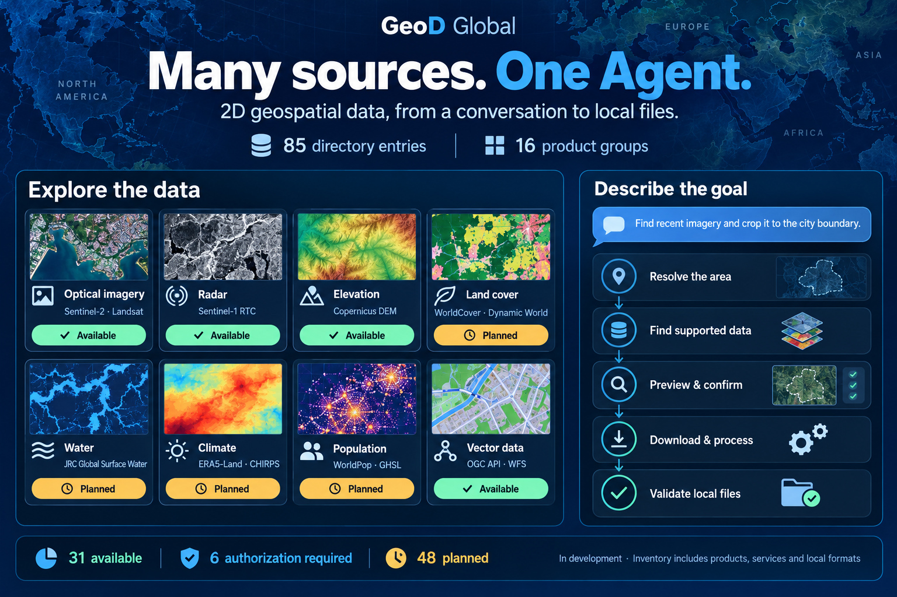
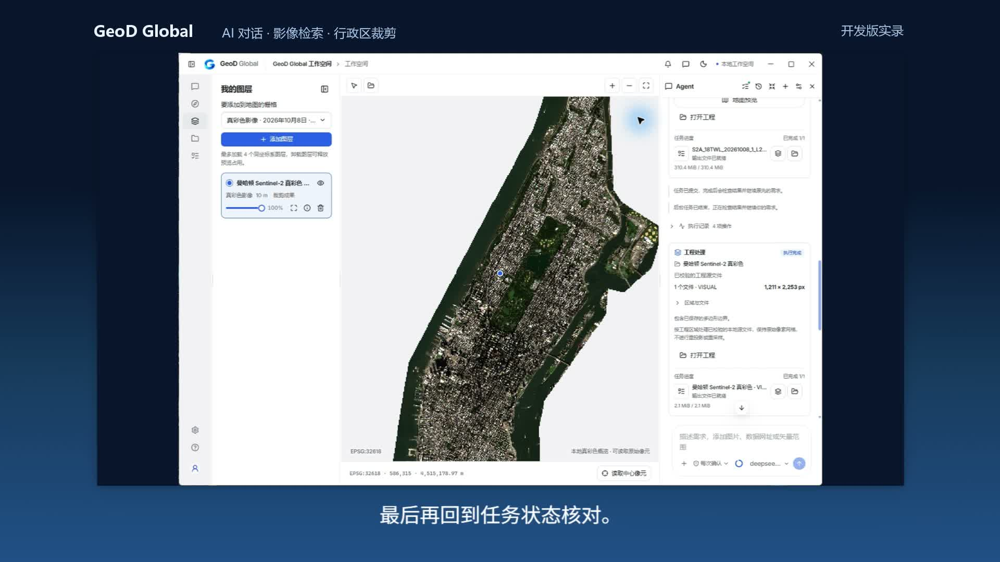
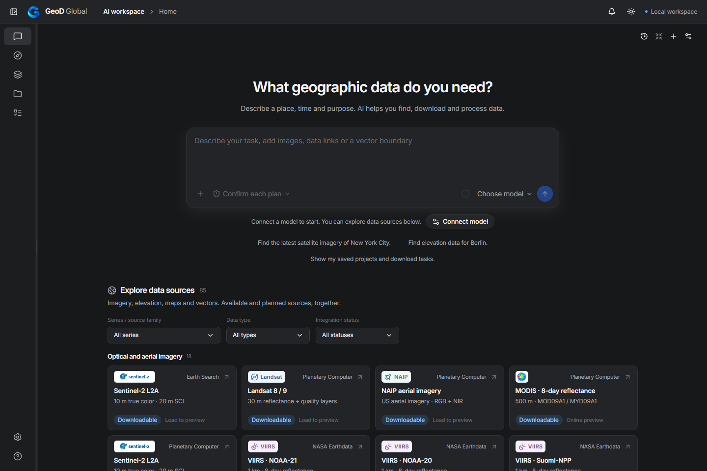
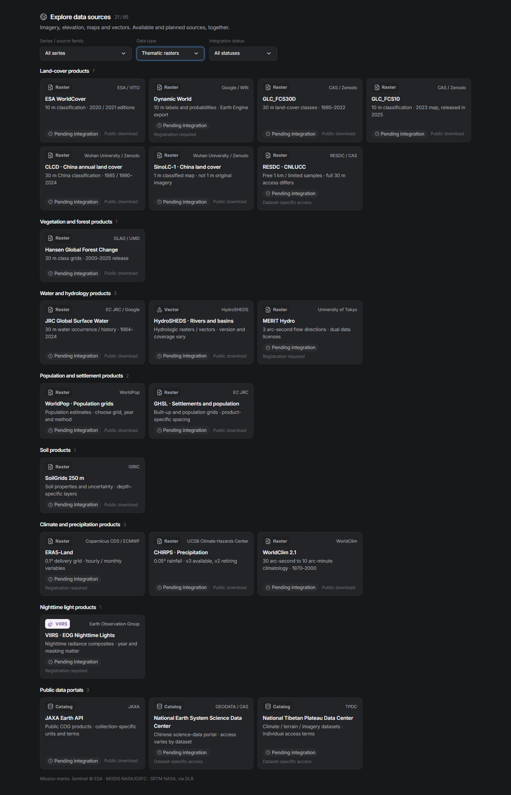
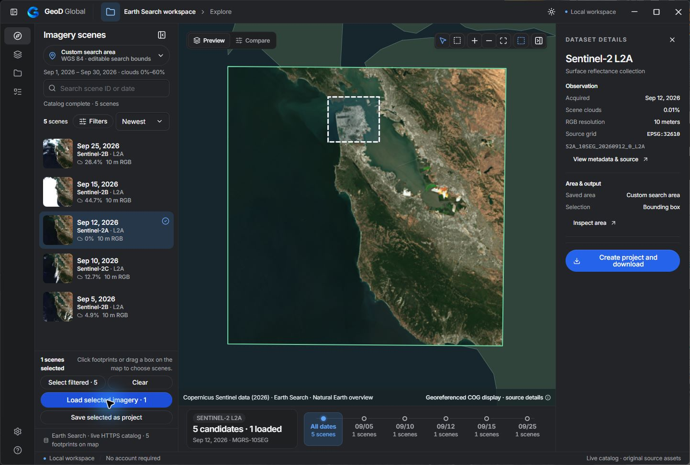
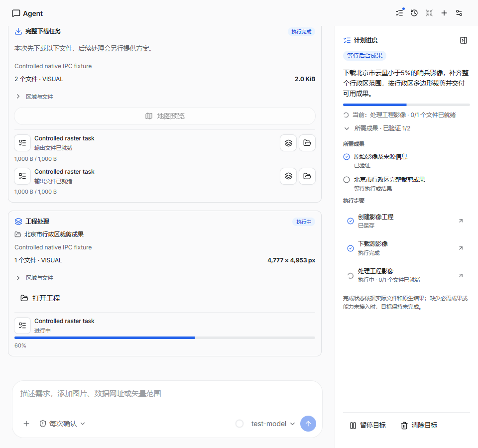
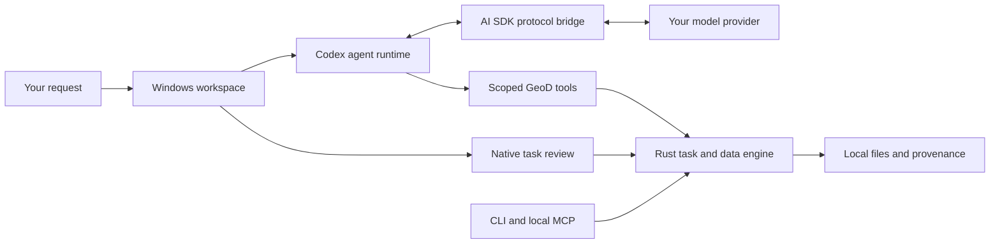

<div align="center">



### Rich data sources. Goal-driven Agent.

Explore a growing **2D data directory** and let an **Agent** turn your place, time range and desired output into a reviewed download and processing task, in one Windows workspace.

[](src-tauri/README.md) [](docs/development-preview.md) [](LICENSE) [](https://github.com/gaopengbin/geod-global/actions/workflows/check.yml)

**[Quick start](#quick-start)** · **[Data sources](#a-growing-2d-data-directory)** · **[Agent architecture](docs/agent.md)** · **[Releases](https://github.com/gaopengbin/geod-global/releases)** · **[Feedback](https://github.com/gaopengbin/geod-global/issues)**

English · [简体中文](README.zh-CN.md)

</div>

## Watch a real Agent workflow

[](https://geod-global.laogao.xyz/index.html#demo)

**[Watch the 3:10 walkthrough](https://geod-global.laogao.xyz/index.html#demo)** — Chinese narration and subtitles. A real Windows development recording: request Sentinel-2 imagery for Manhattan, inspect the administrative polygon and coverage, confirm the task, download the original, crop a local GeoTIFF, and inspect that same newly generated result. Waiting periods are shortened and marked. Copernicus Sentinel data (2026), via Earth Search.

The recording shows a development build; it does not announce a new installer. [Recording provenance](docs/images/README.md#agent-demo-20261009jpg).

| **A rich data-source directory** | **An Agent that follows the goal** |
| :--- | :--- |
| **133 entries across 17 groups**, covering satellite imagery, terrain, thematic rasters, vectors, map services and local files. Product, platform, access conditions and integration status stay visible. | Describe the result in natural language. The **Codex-powered Agent** resolves the area, searches supported data, asks for decisions, prepares a task for confirmation and follows local jobs through file validation. |

<sub>Earlier feature illustration; map thumbnails are decorative and its 85-entry total is historical. The current directory includes products, service connections and local formats: **110 Ready · 2 Auth · 21 Planned.** [Current SinoLC original acceptance](docs/sinolc-shanghai-original-20261014.md). [Image provenance and generation prompt](docs/images/README.md#agent-data-overviewpng).</sub>



<sub>Earlier development frontend, October 7, 2026. Captured with an empty controlled workspace; no model request or download is represented. [Visual provenance](docs/images/README.md).</sub>

## Agent mode: from a request to a local result

Ask for a place, time range and intended output. GeoD helps resolve the area, discover supported products, preview the selected scenes and prepare a complete task for review. Downloads and supported processing run in the local Rust engine; results retain their source identity and checksums.

> “Find recent Sentinel-2 imagery for Beijing, with scene cloud cover below 5%, cover the administrative area and crop the result to its boundary.”

| Describe & clarify | Preview & review | Execute & inspect |
| :--- | :--- | :--- |
| Natural-language dialogue, streaming replies, model connections and option cards for decisions. | Administrative polygons, a right-side map preview with multiple scenes, and complete task cards. | Persistent local jobs, compatible-grid crop/mosaic, source-pixel inspection and documented export paths. |

When a goal is set, a side panel tracks its steps, pending decisions, jobs and verified outputs. By default, the user confirms the complete task before execution. An explicit automatic-execution preference is handled through the native permission policy. Completion follows settled jobs and validated files, rather than the model's wording.

[Goal workflow](docs/agent-goals.md) · [Decision cards](docs/agent-conversation.md) · [Area and coverage checks](docs/agent-area-coverage.md) · [Map preview](docs/agent-map-preview.md)

## A growing 2D data directory

**133 entries · 17 groups · 110 Ready · 2 Auth · 21 Planned**, checked from the October 19 development directory. **23 directory entries remain outside Ready.** The [generated scope](docs/releases/source-scope.json) tracks stable IDs and partial actions; directory totals do not count fully verified collections. [Actual NASA originals](docs/nasa-original-acceptance-20261015.md), [SRTM NUM](docs/srtm-num-original-acceptance-20261015.md) and [global GEBCO TID](docs/gebco-tid-originals-20261015.md) have complete-file, numerical and normal-reopen evidence. GEBCO whole elevation, additional product families and portals remain scoped pending work. Ready is a product-scoped entry, not acceptance of every global original or every user entitlement.

| Imagery & terrain | Environmental products | Thematic & vector products | Connections & files |
| :--- | :--- | :--- | :--- |
| Optical & aerial **21** | Land cover **14** | Population & settlements **7** | Offline map archives **1** |
| SAR radar **2** | Vegetation & forest **10** | Soil **2** | Raster catalogs & coverages **9** |
| Elevation & bathymetry **15** | Water & hydrology **5** | Nighttime lights **2** | Local 2D files **7** |
| Map imagery & history **7** | Climate & precipitation **12** | Vector datasets & services **9** | Public data portals **5** |
| — | Ocean products **5** | — | — |

<sub>Entry counts, including planned items, from the current [source registry](prototype/src/source-directory.js). The four columns are a reading aid; each named group matches a product-board section.</sub>

<details>
<summary><strong>See a captured data-source board — 21 thematic entries across 8 product groups</strong></summary>



<sub>Earlier local capture in English with the thematic filter selected; current integration statuses are in the source registry. Pending entries have no connection action. This capture makes no model or data-provider request. [Capture scope](docs/images/README.md#data-source-board-enpng--data-source-board-zh-cnpng).</sub>

</details>

| Product family | Current development scope |
| :--- | :--- |
| **Optical & aerial** | Sentinel-2 L2A through Earth Search / Planetary Computer, Landsat 8/9, MODIS reflectance, US NAIP and INPE CBERS-4/4A MUX/WFI surface reflectance. CBERS connects four reviewed collections and downloads individual original numerical bands. Product-specific file and processing evidence is documented. |
| **SAR & elevation** | Sentinel-1 IW RTC VV/VH/HH/HV; public Copernicus DEM GLO-30 / GLO-90. Formats, grids and units remain product-specific. |
| **Vegetation & quality** | MODIS NDVI/EVI and supporting science layers; documented Landsat/MODIS quality screening and scientific RGB. |
| **Curated public products** | **72 built-in product connectors / 114 numerical layer options**, counted from the actual native `/datasets` catalog; these product/layer counts differ from the 133 directory entries. Published years, regions, original grids, units, NoData and quality limitations remain product-specific. Use the classified Explore picker, review source results, save the selected originals and explicitly download them. [Current pending list](docs/pending-channels-20261014.md). |
| **Protected products** | NASA HLS L30, SRTMGL1, SRTM NUM and three VIIRS platforms: actual protected originals accepted; each user still connects their own Earthdata authorization. Copernicus Sentinel-2 SAFE remains pending protected-original acceptance. |
| **Services & local data** | STAC, COG/GeoTIFF URLs, WCS, WMS/WMTS/XYZ/TMS, ArcGIS, OGC API Features, WFS, bounded Overpass, PMTiles, supported local vector/tile files and independent bounded local GeoTIFF import. |
| **Research candidates** | **24 Planned entries and 6 Auth entries** retain explicit integration or real-account acceptance gaps. Existing protocol support and an external research download do not establish a completed product connector. [Product-specific pending work](docs/pending-channels-20261014.md). |

OpenLandMap 2024 processed nighttime-light DN is now connected: the fixed 2024 original has complete software download, raw-pixel, preview and reopening evidence, including [actual Explore acceptance](docs/new-public-channel-sst-nightlights-amazonia-20261013.md). It remains processed DN with unresolved source calibration declarations, not calibrated radiance or a complete VIIRS archive. The [October 12 interrupted transfer](docs/next2-nightlights-connection-diagnostic-20261012.md) is retained as historical failure evidence.

The existing `enmap` entry now supports [one complete official Nevada L2A 224-band ENVI example](docs/enmap-original-acceptance-20261015.md), with original ZIP/BSQ/HDR checksums, selectable-band local previews, raw spectra and normal reopen. This is a finite official example, not global EnMAP scene discovery. Original redistribution remains restricted by the EnMAP licence.

The existing `merit-hydro` entry now offers [three fixed MERIT Hydro IHU 5 arc-minute originals](docs/merit-ihu-originals-20261015.md): flow direction, upstream area and stream order. They passed complete software downloads, raw values and normal reopen. The original 90 m scope remains Planned; that IHU action adds or clears no directory ID.

The preceding expansion batch added ten independent products: GHSL area, volume and population, ETH canopy height, HydroSHEDS accumulation, ETOPO geoid, HREA, BII and two NOAA climate products. Their [eleven-original acceptance](docs/new-public-channel-next-ten-20261014.md) passed actual Explore, full software downloads (**1,429,629,635 bytes**), complete hashes, **66 representative raw samples**, unchanged objects/PNGs after restart, and **eleven actual UI project reopens**. These selected originals do not certify the whole directory. HydroSHEDS whole-tile previews remain very dark, and one original-mask-excluded BII ocean pixel remains explicitly rejected by the strict raw decoder; [the public receipt](docs/next-ten-public-channel-acceptance-20261014.json) preserves these limits. Local desktop builds do not imply installer, launch or deployment acceptance. The [preceding ten-product batch](docs/new-public-channel-ten-products-20261014.md) retains its separate receipts.

The preceding original-backlog round completed WorldClim Nepal climate normals, two FABDEM tiles, reviewed GLC_FCS10 / GLC_FCS30D tiles, corrected SoilGrids WRB 2017 tiles, one Vantor Nepal visual original, bounded Microsoft building partitions, the Monaco Geofabrik free GIS bundle, one Overture bathymetry GeoParquet part and independent local GeoTIFF import. Complete source files, separate archive/member or original/preview hashes, actual maps, raw values or original properties, exports and reopening are documented in the [ten-original-ID acceptance](docs/original-backlog-channel-acceptance-20261014.md). Global archives, unsupported annual bands, raw PBF, current SoilGrids depth properties and commercial permissions remain outside those finite scopes. Wayback and additional Earth Search collections expose limited actions while their broader families remain Planned.

The current original-backlog batch connects the fixed SinoLC-1 Shanghai classification original: one complete **365,818,022-byte ZIP** and its unchanged **427,679,242-byte TIFF**, actual maps and raw class values, normal restart/reopening, and a fresh Explore query that reuses the completed original with **0 new download jobs**. Its **34 × 30 class-color preview** retains the full **132,000 × 114,000 original grid** for raw-pixel reading. Mixed 2019–2021 input timing and the classification-only CC BY 4.0 licence remain explicit; browser/UI export of this ZIP has not been accepted. [SinoLC original and recovery acceptance](docs/sinolc-shanghai-original-20261014.md). [GEBCO's accepted official numerical-region workflow](docs/gebco-regional-subsets-20261014.md) remains a partial action under Planned, with no original-backlog clearance.

The compact cards group imagery, radar, elevation, land cover, water, population and other products while keeping the provider and access conditions visible. Grid columns adapt to the available panel width.

<details>
<summary><strong>Earlier product-scoped acceptance and scientific boundaries</strong></summary>

The October 12 historical batch added three entries with four reviewed layers: [GHSL GHS-SMOD V2 settlement classes for reference epoch 2020](docs/next2-ghsl-native-acceptance-20261012.json), [GLAD v2 combined land-cover/use for 2020](docs/next2-glad-native-acceptance-20261012.json), and [Maui WV02 multispectral and panchromatic originals](docs/next2-maxar-native-acceptance-20261012.json). GHSL preserves typed NoData -200 and undocumented code 0; GLAD preserves valid code 0 and distinguishes the author's missing-code legend from the checked TIFF's absent scalar NoData tag. GLAD selects from 280 published tiles, while complete native checks cover the selected original. Maui is restricted to one reviewed 2023-08-12 acquisition tile under CC BY-NC 4.0: eight-band MS and single-band PAN raw samples, without calibrated reflectance or RGB conversion. Those historical Maui checks used scalar TIFF NoData flags and did not certify valid imagery coverage; they are not a blanket statement about current mask support. The newer BII connector preserves the original per-layer internal validity mask separately from scalar NoData. Visual YCbCr imagery, other Maui tiles/events and the newer Vantor archive remain outside this historical Maui connector. The separate [current Vantor acceptance](docs/original-backlog-channel-acceptance-20261014.md) covers only one Nepal 2026 JPEG Y/Cb/Cr original, without calibrated scientific or RGB claims. Selection, review, fresh download, local map/raw pixels and reopening are tracked separately in [that historical browser acceptance record](docs/next2-public-channel-browser-acceptance-20261012.md); these checks do not establish a new installer, native-window acceptance or deployment.

The development engine now adds conditional recovery for reviewed public STAC/direct-raster originals. It first revalidates the saved source and selected layer; changed metadata or selection requires a new review. A verified saved prefix is resumed with a strong ETag and `Range` / `If-Range` only when the 206 response retains that ETag and the exact `Content-Range` start and total length. Missing strong validators, changed HTTP file representations or ignored ranges start a fresh transfer; different versions are never joined. Seven local TCP protocol cases and all 12 existing recovery tests passed. The current reviewed-ZIP path additionally permits exact Range recovery against a pinned complete-original SHA and length; its verified saved prefix, precise Content-Range, complete final SHA and safe archive checks remain mandatory. It does not grant generic recovery for arbitrary unversioned files.

One actual Maui multispectral original also completed this recovery path: a natural network failure retained a verified 782,896-byte prefix, then a normal runtime restart and explicit retry of the same task resumed it and verified the complete 12,977,165-byte file. The receipt records `resumed`, rather than a fresh replacement job. This is a selected-original recovery pass, not proof for every provider or a forced-crash test; [the browser record](docs/next2-public-channel-browser-acceptance-20261012.md) tracks this transfer separately from the map, eight-band readout and final reopening. This historical recovery receipt does not announce a new installer or deployment.

Earlier evidence remains product-scoped: [four cross-platform originals and native checks](docs/next-public-channel-native-acceptance-20261012.json), [their browser acceptance](docs/next-public-channel-browser-acceptance-20261012.md), [five products and eighteen originals](docs/new-public-channel-native-acceptance-20261012.md), and [their Explore flows](docs/new-public-channel-browser-acceptance-20261012.md). CHELSA retains the fixed 1981–2010 climate normal; CGLS supports permanent-water fraction only. [WorldCereal](docs/public-dataset-worldcereal-20261012.md), [curated products](docs/public-dataset-curated-20261012.md) and [expansion receipts](docs/public-dataset-expansion-20261012.md) preserve their own regional/year/layer limits. JAXA Research Data credits and advance commercial notice remain required; free delivery is not a CC license.

</details>

[Full source directory and scope](docs/product-scope.md) · [Integration status](docs/provider-integration-status.md) · [Open-data research CSV](docs/research/open-data-sources-2026-10-07.csv)

“Open” may mean public download, registration, a research application or limited samples. A 1 m classified map is not 1 m original RGB imagery; disaster open data is not a free global on-demand archive. The product scope is **2D**, including elevation rasters; 3D models and point clouds are outside the current plan.

<details>
<summary><strong>Map workspace and task progress</strong></summary>



<sub>Real native Windows capture, September 30, 2026; remote imagery preview. Copernicus Sentinel data (2026), Earth Search and Natural Earth overview. It predates the current Agent interface and is not evidence of completed download.</sub>



<sub>Development UI acceptance capture using controlled task state. Demonstrates layout and navigation, not a live acquisition. [Verification record](prototype/qa/agent-plan-sidebar-verification.json).</sub>

</details>

## One native core, several interfaces



Codex owns the Agent loop; the AI SDK adapts the selected model protocol. Native GeoD tools handle geographic queries, plans and file operations. Desktop, CLI and local MCP share the Rust core. Model credentials use the Windows credential vault, with separate histories for each connection. The workspace runs locally; conversations and selected attachments still contact the configured model provider, and data requests contact their providers.

[Agent implementation and acceptance](docs/agent-integration-status.md) · [CLI/MCP setup](docs/mcp.md) · [Attachments](docs/agent-documents.md)

## Quick start

The **[v0.2.0-rc.4 Windows evaluation](https://github.com/gaopengbin/geod-global/releases/tag/v0.2.0-rc.4)** includes the conversational Agent, source board and independent Global account entry. It is an unsigned prerelease with portable ZIP and per-user installer; see the [release scope and acceptance gaps](docs/releases/0.2.0-rc.4.md). The earlier rc.3 predates the Agent.

For the native app, use **Windows x64**, Node.js **22.13+**, npm **10+**, Rust **1.91.1+**, Visual Studio C++ Build Tools and WebView2. From the repository root:

```sh
git clone https://github.com/gaopengbin/geod-global.git
cd geod-global
npm ci
npm run agent:prepare
npm run desktop:dev
```

`agent:prepare` prepares the pinned Windows Node/Codex runtime and its license inventory. Connect your model in the app; start with a place and a task. See [desktop setup](src-tauri/README.md) and [development guide](docs/development-guide.md).

<details>
<summary><strong>Browser preview, builds and checks</strong></summary>

```sh
# Browser UI at http://127.0.0.1:4317/
npm run dev

# Optional browser companion at http://127.0.0.1:4318/
npm run runtime

# Embedded debug desktop; no installer
npm run desktop:build

# Python 3.12 dependencies for contract/fixture checks
python -m pip install -r requirements-dev.txt
npm run verify:all
```

The in-app Agent and secure model setup require the native Windows application. A browser preview is not a substitute for desktop capability acceptance. Test fixtures, controlled UI captures and live data evidence are recorded separately.

</details>

## Development status

Official services now have a local beta implementation: server-verified Pro access and service credits, bounded Sentinel-2/Landsat monitoring, notifications, and human-confirmed Agent review cards. Existing local downloads, processing and BYOK remain available. Payments are an invitation-only sandbox adapter; live sales, hosted AI and cloud processing are not enabled. [Implementation and setup](docs/official-aggregation-service.md).

Update controls and the notification center are implemented in development. The independent signed production channel awaits a new signed release; development builds do not install updates. [Updates and size audit](docs/software-updates.md).

Supported crop/mosaic and science workflows have product and grid limits. General reprojection, arbitrary cross-grid processing, additional adapters, remaining protected originals and clean-machine release acceptance remain separate work. [Current limitations](docs/provider-integration-status.md) · [Latest local development notes](docs/development-preview.md).

## Documentation & contributions

| Start here | Explore further |
| :--- | :--- |
| [Development setup](docs/development-guide.md) | [Product specification](GeoD-Global-Spec/00-README.md) |
| [Agent workflows](docs/agent.md) | [Processing and recipes](GeoD-Global-Spec/11-Executable-Processing-and-Recipes.md) |
| [SCL crop walkthrough](docs/workflows/clip-sentinel-scl.md) | [Windows packaging](docs/releases/windows-packaging.md) |
| [Data-provider evidence](docs/providers.md) | [Workspace and delivery](GeoD-Global-Spec/12-Workspace-Agent-and-Distribution.md) |
| [Official aggregation service](docs/official-aggregation-service.md) | [Free / Pro design](GeoD-Global-Spec/16-Free-Pro-and-Usage-Design.md) |

Have a real task or an open dataset to suggest? [Open an issue](https://github.com/gaopengbin/geod-global/issues) with the place, product, period and desired output. For a data source, include its official download entry, coverage and access terms. Keep credentials and private client data out of reports.

## License

First-party code is **[GPL-3.0-only](LICENSE)**, © 2026 Gao Pengbin. Commercial use is permitted under the GPL, with its source and distribution obligations. [Separate commercial permissions](COMMERCIAL-LICENSING.md) may be discussed. Third-party software, datasets, mission marks and other assets retain their own terms.

<div align="center"><sub>GeoD Global · Independent software by Gao Pengbin · Keep the data. Keep its context.</sub></div>
