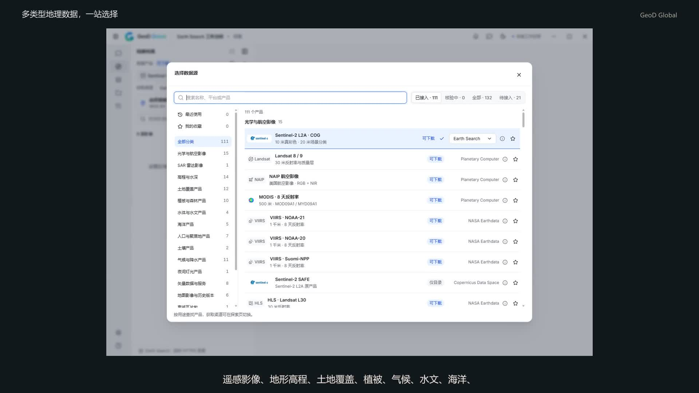
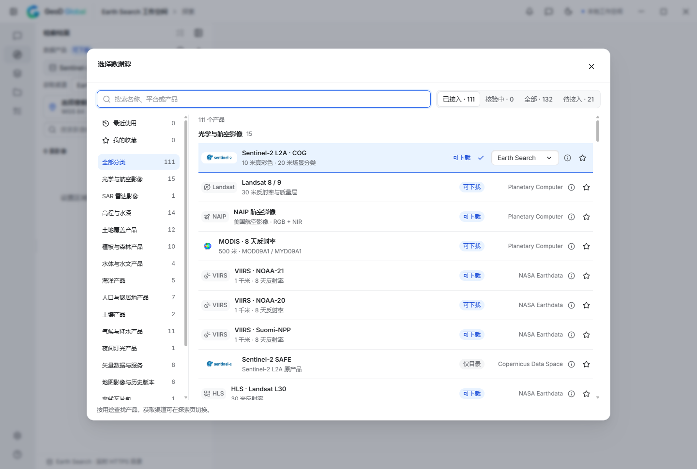
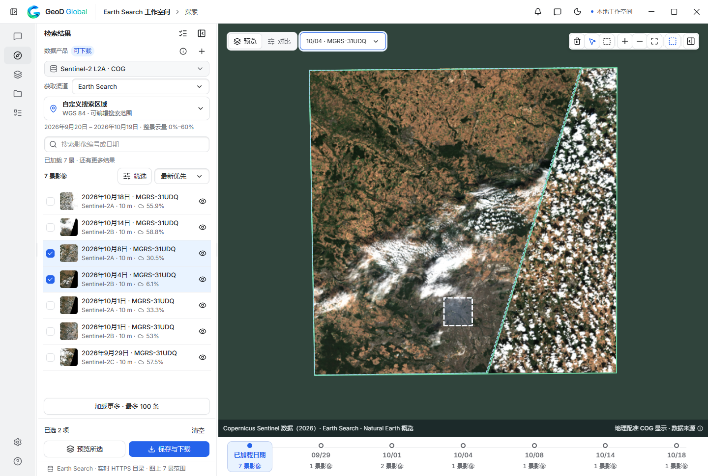

# GeoD Global
**Imagery, terrain, thematic data, vectors and map services in one workspace.**

**遥感影像与地理空间数据下载工具**：聚合卫星影像、DEM 高程、土地覆盖、气候海洋、人口、矢量与地图服务；支持区域检索、多选地图预览、下载与本地成果管理。

**[中文介绍](README.zh-CN.md) · [中文官网与 CDN 下载](https://geod-global.laogao.xyz/zh/index.html#download)**

   

**[Download 0.2.4 · CDN](https://geod-global.laogao.xyz/index.html#download)** · **[Website](https://geod-global.laogao.xyz)** · **[Feedback](https://github.com/gaopengbin/geod-global/issues)**

English · [简体中文](README.zh-CN.md)

A Windows workspace to choose data by type, search an area, preview selections and download local results.
Explore manually or connect your own model to prepare searches and download tasks with the Agent.
**Local use requires no Global account.**

**17 categories · 110 available entries · 2 authorization entries**

Earth Search · Microsoft Planetary Computer · NASA Earthdata / GIBS · JAXA public products · INPE / Brazil Data Cube · OpenTopography · Geospatial Data Cloud

常用渠道：Sentinel、Landsat、NAIP、Copernicus DEM、NASA、JAXA、地理空间数据云。产品覆盖范围与账号要求请查看[中文数据介绍](README.zh-CN.md#可以找哪些数据)。

## Start with a concrete task

| Task | Start here | What to check |
| :--- | :--- | :--- |
| Landsat batch download | [Worked case and first-run steps (Chinese)](https://geod-global.laogao.xyz/zh/workflows/landsat.html#first-run) | Start with one scene and B4/B3/B2; confirm three completed source files, then open the local RGB result |
| Sentinel-2 imagery | [Search and source-file guide](https://geod-global.laogao.xyz/workflows/sentinel-2.html) | Area, date, cloud cover and scene coverage before download |
| GLO-30 elevation | [Public-tile and elevation guide](https://geod-global.laogao.xyz/workflows/elevation.html) | Product coverage, source values and georeferencing for your GIS workflow |

The Landsat case was run on October 23, 2026: three dates, nine complete source-band GeoTIFFs, 798,438,650 bytes, with SHA-256 and full block decoding checked. It does not claim an AOI crop, QA masking or an all-band package. The [2.2 KB parameter pack](https://geod-global.laogao.xyz/assets/cases/landsat-20261023/Landsat-first-task-parameters.zip) contains manual query settings and instructions, not imagery, software or an importable project.

If a task gets stuck, [report its stage](https://github.com/gaopengbin/geod-global/issues/new?template=data-workflow.yml): installation, startup, search, preview, confirmation, transfer or opening results. Include the app version, provider and visible error; leave out credentials, signed URLs and private data.

## Watch the features

**[Watch the 62-second feature video](https://geod-global.laogao.xyz/index.html#demo)** · [MP4 in this repository](docs/media/geod-global-0.2.0-features.mp4)

Data types and channels, area search, multiple selection and map preview, downloads and local results. Recorded in the installed Windows 0.2.0 app, with Chinese narration and subtitles.

## Find the data you need

| Data type | Connected products and channels |
| :--- | :--- |
| Optical and aerial imagery | Sentinel-2, Landsat, NAIP, MODIS, VIIRS, HLS; public CBERS and EnMAP products |
| SAR radar | Sentinel-1 RTC |
| Elevation and bathymetry | Copernicus DEM, SRTM, NASADEM, ALOS AW3D30, USGS 3DEP, ETOPO, SRTM15+ |
| Land cover | ESA WorldCover, Esri / Impact Observatory, GLAD, GLC_FCS, CLCD 2004, SinoLC-1 Shanghai |
| Vegetation and forests | MODIS NDVI / EVI, Hansen forest change, GEDI canopy height, Global Mangrove Watch, JAXA forest products |
| Water and hydrology | JRC surface water, HydroSHEDS flow direction and accumulation, DE Africa annual water observations |
| Ocean | Sea-surface temperature, surface wind, chlorophyll and ocean heat content from JAXA and NOAA |
| Population and settlements | WorldPop, GHSL, World Settlement Footprint, HREA |
| Soil | JAXA soil moisture, SoilGrids WRB 2017 |
| Climate and precipitation | CHIRPS, CHELSA, NOAA NClimGrid; JAXA land-surface temperature, rainfall, radiation, evapotranspiration and aerosol products |
| Nighttime lights | OpenLandMap annual nighttime-light DN products |
| Vector data and services | geoBoundaries, OpenStreetMap / Overpass, WFS, OGC API Features, ArcGIS Feature Service; public Microsoft building and Geofabrik files |
| Map imagery services | NASA GIBS, WMS, WMTS, XYZ, TMS, ArcGIS MapServer / ImageServer |
| Offline maps | Protomaps / PMTiles public tile archives |
| Raster catalogs and coverages | STAC API, static STAC, single Items, COG / GeoTIFF URLs, WCS; download links exported from your own Earth Engine project |
| Local files | GeoTIFF / COG, GeoJSON, GeoPackage, Shapefile, OSM XML / PBF, PMTiles, MBTiles |
| Data portals | Geospatial Data Cloud: connect your account to search and download supported products |

The directory contains **133 entries**, including products, protocols and local formats, with **21 planned entries**.
Products have version, region and file boundaries. See the [full data catalog](docs/data-catalog.md) for individual scope and access conditions.

## One path from source to result

| Choose | Explore | Confirm | Download | Inspect |
| :--- | :--- | :--- | :--- | :--- |
| Classified products and access conditions | Compact lists, multiple selection, map preview | Source, area, files and destination | Persistent jobs and explicit outcomes | Local files, provenance, checksums and source pixels |

- **Latest 100 results first:** load more on demand. NAIP prefers the latest acquisition year; changing areas does not enumerate all historical data.
- **Bring your own model:** scoped native tools, task review and persistent jobs. Home conversations and Explore sidebar tasks retain separate selection contexts.
- **Source-aware results:** multiple-layer preview, raw-pixel inspection and supported compatible-grid crop/mosaic. Rendered exports and scientific originals stay distinct.

Installed 0.2.0, October 19, 2026. Copernicus Sentinel imagery via Earth Search. [Image provenance](docs/images/README.md) · [Release acceptance](docs/releases/0.2.0-acceptance.md).

## Get started

1. Download the **Windows x64 setup EXE** or complete portable ZIP from the [website CDN downloads](https://geod-global.laogao.xyz/index.html#download); [GitHub is also available](https://github.com/gaopengbin/geod-global/releases/latest).
2. Microsoft Edge WebView2 Evergreen is required. No separate Node, Rust, Python or system GDAL is needed.
3. Choose a source and area in Explore, search, select results and review the download. Connect your own model in Settings for Agent mode.

Files are **unsigned**. Check SHA256SUMS.txt and the release manifest; checksums are not a Windows publisher signature.
Quit via the tray before manual upgrades. Uninstall preserves user data. [Windows instructions](docs/releases/WINDOWS-README.md)

## Access, privacy and scope

Data-provider accounts and licenses remain separate. Protected sources need your own access.
Earth Engine uses your project and may consume its quota. Planned entries are not finished integrations.

Anonymous usage statistics are **on by default**, with off controls in Settings and saved opt-outs preserved.
They exclude conversations, keys, account details, precise locations, scene IDs and file paths. [Data boundary](docs/usage-analytics.md).
Model requests contact your configured provider; data requests contact the source.

This release focuses on **2D data**, including elevation rasters. Hosted AI, live paid services, cloud sync,
general cross-grid processing and non-Windows installers are not included.
[Source scope](docs/releases/source-scope.json) · [Provider status](docs/provider-integration-status.md) · [0.2.4 notes](docs/releases/0.2.4.md) · [Release verification](docs/releases/0.2.4-acceptance.md)

## Develop and contribute

Windows x64 development requires Node 22.13+, npm 10+, Rust 1.91.1+, Visual Studio C++ Build Tools and WebView2.

Run npm ci, npm run agent:prepare, then npm run desktop:dev from the repository root.

[Development guide](docs/development-guide.md) · [Agent architecture](docs/agent.md) · [CLI / MCP](docs/mcp.md) ·
[Processing example](docs/workflows/clip-sentinel-scl.md) · [Packaging](docs/releases/windows-packaging.md)

Suggest datasets and report reproducible problems through [Issues](https://github.com/gaopengbin/geod-global/issues).
Include product, period, steps and version; exclude credentials and private client data.

## License

First-party code: **[GPL-3.0-only](LICENSE)**, © 2026 Gao Pengbin. Commercial use is permitted under GPL obligations.
[Separate commercial permissions](COMMERCIAL-LICENSING.md) may be discussed. Datasets and components retain their own terms.
