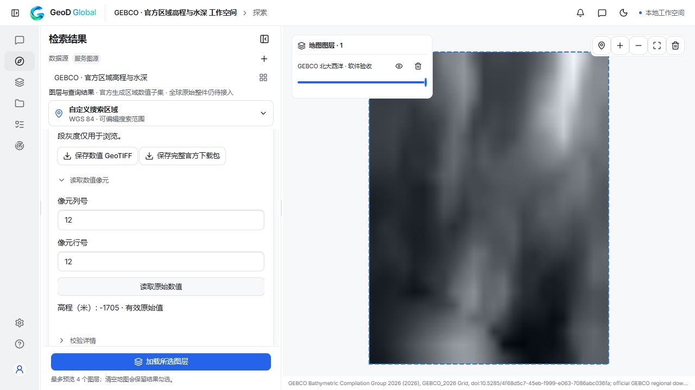

# GEBCO 官方区域数值子集 — 2026-10-14

已把 GEBCO 官方区域生成服务接入统一 Explore：选择区域和数据源，生成数值子集，勾选结果上图，读取原始像元，并分别导出完整官方下载 ZIP 与数值 GeoTIFF。成果可在“我的数据 → GEBCO 区域成果”重新加载，不需要重新排队生成。

这条路径是 **GEBCO 2026 官方生成的区域数值子集**。原稳定 ID `gebco` 继续保持 Planned，全球原始整包没有由区域子集代替，也不增加原计划核销数或新目录 ID。

## 实际软件验收

真实 Explore 操作请求范围为 `[-30.1, 40, -30, 40.1]`，保存成果 `bdc8afe6-4dd8-45ad-b01d-6b75366255bd`。界面实际生成、上图、读取中心像元和双文件导出已通过，“我的数据”普通重开后中心原值保持 **−1705 米**。

| 文件 | 完整字节数 | SHA-256 |
| --- | ---: | --- |
| 官方生成 ZIP，包含 TIFF、产品说明和使用条款 | 421,346 | `31926c37d1efab247311f6b8051685de54bf8b0991b256ac2fdb032078729c4f` |
| 数值 GeoTIFF | 8,992 | `c96b1b1905403c5b8462ab32bfb5ae48c754ac2b0d9aeb7648331b9c27ea595e` |

浏览器实际导出的两个文件均与软件记录的完整长度和 SHA 一致，ZIP 全部成员通过 CRC 检查。独立 GDAL 与 tifffile 对全部 576 个数值一致；五个软件原生像元读取也符合独立参考。测试内核普通重启及中断后恢复时，保存文件的全部哈希保持不变；完整检查对象和 PNG 与重启前一致，实际“我的数据”页面重新加载的地图及中心原值仍为 −1705 米，没有重新生成或下载。[实际软件及重启验收摘要](gebco-regional-subsets-20261014.json)。

生成文件的历史标签包含实际生成任务和时间，所以每次请求的文件 SHA 可以不同。保存每次文件的真实校验值，不改写标签以凑出固定原件哈希。

## 科学及交付范围

- 数值网格为 EPSG:4326 面像元登记、15 角秒间距、Int16 米值。负值表示海底高程，NoData 为 −32767；不改符号或单位。
- 2026 是网格发布版本，不是统一观测日期。数据是地形汇编，不保证某点已有现场测量或可用于航海安全。
- 仅选择官方 surface-elevation 数值 GeoTIFF；TID 来源类别、渲染地图和其他格式不替代地形数值。
- 完整 ZIP、展开累计文件、保存 TIFF 均维持 32 MiB 限制，轴长和解码预算仍受限。没有抬高用户 GEE 导出或普通本地栅格限制。
- 保留包内的官方说明、使用条款、署名、原始请求、目录和生成回执。接入不需要 Google 项目、账号、发信地址或访问凭据。

## 网络验收及修复

本轮实际 UI 的首次提交遇到连接失败，第二次提交后状态查询连接失败，失败记录保留。修复后同一目录、同一生成任务的只读查询和下载最多尝试四次，总生成等待仍不超过三分钟；连接或响应中断、408、429、5xx 可重试，错误区域、格式、大小或来源语义不重试。**生成 POST 不自动重试**，避免在响应不明确时重复排队。

模拟网络测试确实验证了断开的 GET 和暂态 HTTP 后恢复到同一生成任务，且只提交一次 POST；永久失败会明确报告，不声称所有网络环境都稳定。随后上述真实 UI 请求完整通过。

实现与证据边界：[本轮地图与替代渠道研究](research/remaining-maps-20261014.md)、[当前原计划待办](pending-channels-20261014.md)。真实软件、完整文件、独立原值、界面、重启、安装版和发布各自记录，不互相代替。
