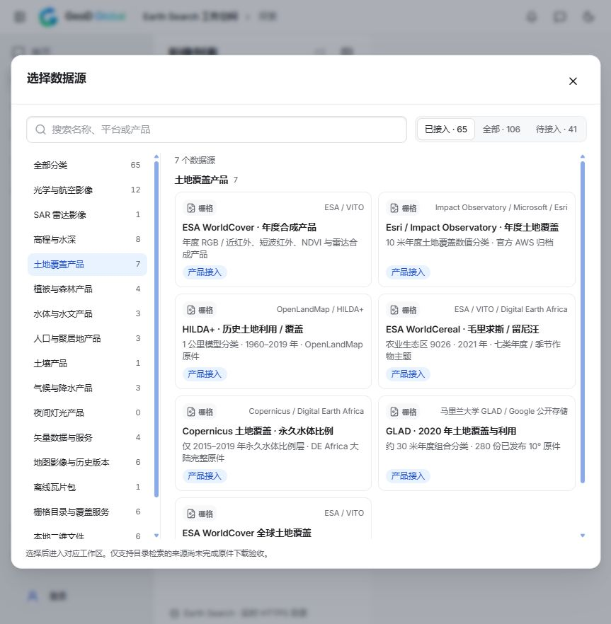
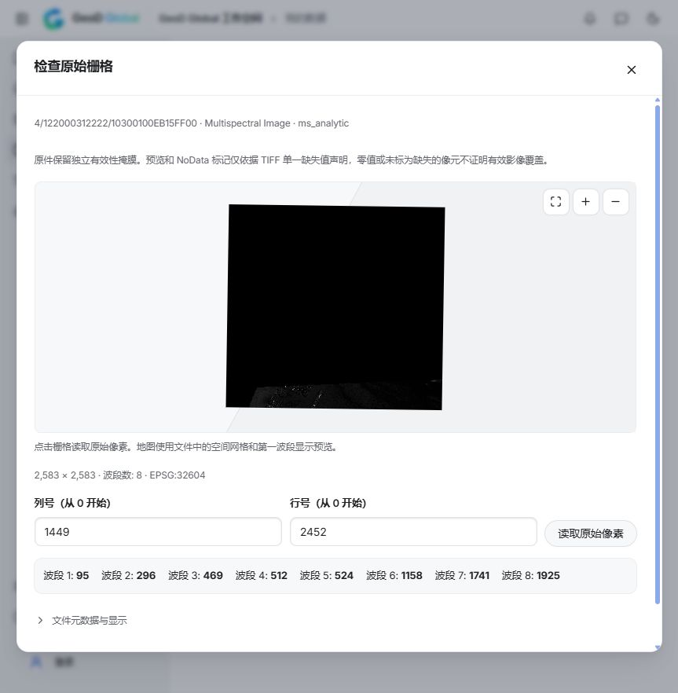

# GHSL、GLAD 与 Maui 公共渠道：实际界面验收

本批三种产品、四份精选原件的实际界面验收通过，共下载 101,498,851 字节。本文只记录这些精选原件的真实下载与界面操作，不代表完整平台目录、所有 GLAD 分幅或其他 Maxar/Vantor 事件均已验收。

已从探索页的分类弹窗分别进入 GHSL 2020 聚居地分类、GLAD 2020 土地覆盖以及 Maui 2023 年 8 月的两个分析图层。各次操作均先填写范围、审阅真实来源、读取元数据、选择文件、保存新工程，再显式下载。Maui 多光谱切换为全色时，旧资产选择与保存确认清空，必须重新审阅；未选分析层和 visual 资产不可误选。

初次界面下载遇到了真实网络中断。GHSL、GLAD 和 Maui 全色已完成完整原件校验及界面预览；Maui 多光谱也已在补上条件续传后完整下载。保留旧版本四次失败、一次测试主动取消和新版本一次自然网络失败的记录。主动取消会清理断点，网络失败在强版本校验成立时保留断点。

Maui 多光谱第 4 次尝试自然失败，保存了 782,896 字节前缀；前缀 SHA、来源与选层绑定、强 ETag 经独立复核。所有任务结束后正常重启本地预览，再从界面明确重试同一任务，第 5 次尝试记录 `resumed`、`resumedBytes: 782896`，完整 12,977,165 字节的 SHA-256 为 `0fb2472eab96eda7f298d97c6b8f44ad89c773f079576d7983759e546f2ad5b6`，与独立原件一致。生产代码仅在强 ETag、精确 206 Content-Range、传输编码与剩余长度校验全部通过后记录 resumed；本次未抓包，不把这一记录伪称为原站 HTTP 响应抓包。没有实施强制崩溃测试。

已有界面原值记录：GHSL 城市中心分类代码 30、未定义但非 NoData 的 0、真实缺失值 -200；GLAD 有效 0 和耕地代码 244；Maui 全色原值 470 和独立掩膜之外的 0。Maui 预览与 NoData 标签只使用单一 TIFF NoData，界面明确说明独立有效性掩膜尚未用于这些标签。GHSL 地图只适配物理 WGS84 范围，全部 43,202 列和原始空间网格保持不变。

Maui 多光谱原始像素 `(1449, 2452)` 在界面显示八个波段值 `95, 296, 469, 512, 524, 1158, 1741, 1925`；`(0, 0)` 显示八个零值并保留独立掩膜提示。最后再次正常重启相同定稿预览，四个工程均从界面重新打开地图并读取已知原始像素，未重新下载。之前的 16 个任务、14 个工程原记录保持不变；加本批四个工程后共 20 个任务、18 个工程。

数据源弹窗当前显示 106 个目录入口、16 种产品分类，已接入筛选包含 59 个可用入口与 6 个授权/目录入口，另有 41 个待接入入口。原生公开栅格产品目录为 27 种产品、60 个分析图层；这些数量的口径不同，不能互相当作全部整文件验收数量。

夜间灯光仍为待接入候选。正式 Zenodo 文件地址解决了 API 的 Accept/406 问题，但整文件传输仍中断，不能将独立 Range 恢复出的参考原件当作软件验收成功。Vantor 2026 新目录的 JPEG/YCbCr 原件也尚未通过当前原值读取器验收。

- [GHSL 原生验收](next2-ghsl-native-acceptance-20261012.json)
- [GLAD 原生验收](next2-glad-native-acceptance-20261012.json)
- [Maui 原生验收](next2-maxar-native-acceptance-20261012.json)
- [四份界面成果的原生只读审计](next2-public-channel-browser-native-audit-20261012.json)
- [真实界面操作、截图及重开记录](../prototype/qa/next2-public-channel-ui-verification-20261012.json)
- [夜间灯光连接诊断](next2-nightlights-connection-diagnostic-20261012.md)

本轮仅更新本机开发预览。未发布安装包、部署官网或声称原生桌面窗口通过验收。
