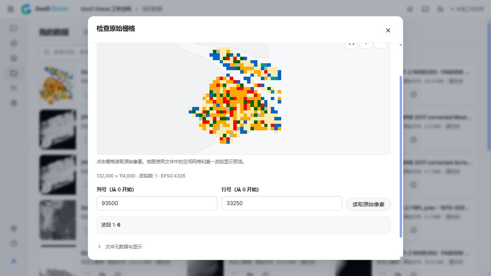
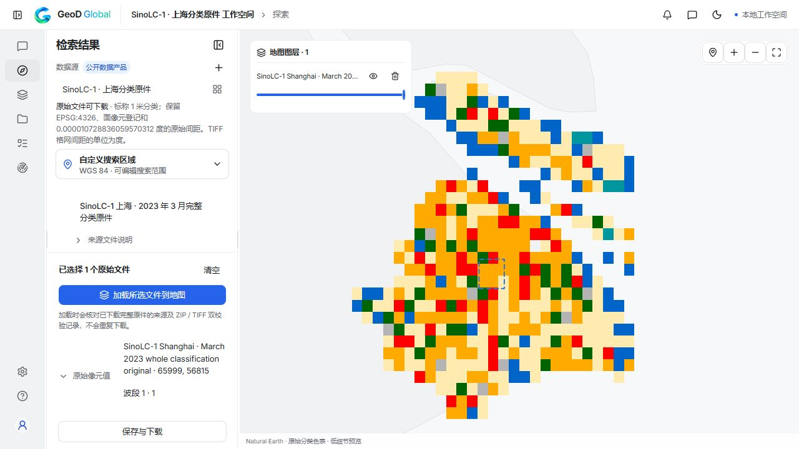

# SinoLC-1 上海分类原件接入验收 — 2026-10-14

本批完成并核销 **1 个原 Planned 稳定 ID `sinolc-1`，额外新增 0 项**。范围仅为作者 2023 年 3 月固定发布的上海分类原件：实际 Explore 发起完整软件下载、分类地图与原像元、“我的数据”打开成果、普通重启重开，以及重新检索后复用既有原件均已通过。目录由 **133 / 101 Ready / 6 Auth / 26 Planned** 更新为 **133 / 102 Ready / 6 Auth / 25 Planned**；连同[前轮十项](original-backlog-channel-acceptance-20261014.md)，原 36 条 Planned 累计核销 11、仍余 25。一个 ZIP、成员、类别或像元不另算渠道。[机器可读验收摘要](sinolc-shanghai-original-20261014.json)、[当前待办](pending-channels-20261014.md)。

GEBCO 已有[官方区域数值子集闭环](gebco-regional-subsets-20261014.md)，原 ID `gebco` 仍为 Planned 并提供有限动作；区域子集不替代全球原始整包，对本批原核销与额外新增均计 0。

截图为实际软件成果检查，原列 93500 / 行 33250 读回分类代码 6。地图是 34×30 粗分类颜色预览；132000×114000 是保留的完整原网格。

## 完整软件下载与同任务恢复

软件任务 `5126af30-4d4e-49b4-a255-7fbb91e25727`，工程 `58084150-0d98-40eb-b0c2-887481366f96`。任务于 **2026-10-14 12:12:43 UTC** 从实际 Explore 发起，第 5 次尝试在 **13:53:53 UTC** 更新为 succeeded。软件保留完整原 ZIP 与完整 TIFF 成员，分别核对字节数和完整 SHA-256，ZIP 全部成员通过 CRC 检查。完整软件文件没有由独立研究原件拷贝替代。

| 文件 | 完整字节数 | 完整 SHA-256 |
| --- | ---: | --- |
| 作者 `East_Shanghai.zip` | 365,818,022 | `f128cae66f38c546a850af767b42b85d29fd0c4d71ee3bb325e30b962d58d268` |
| 包中完整 `East_Shanghai.tif` | 427,679,242 | `5cd5c24c414fdb3cadb89c53429d5987de70ea605e0100a9b4a83a2257b48830` |
| 分类浏览 PNG | 811 | `745d25905ebdb23da73965de9348b1138c451e20fedcd4a569c599f356f69eb4` |

作者 ZIP 声明的发布方 MD5 为 `c898994fa496d915f73b2ffd102d93ca`。以上 SHA-256 是完整文件校核所得，不称发布方提供的 SHA。

前四次真实失败及第 5 次恢复保留：

| 尝试 | 结束时已下载字节 | 恢复起点 | 结果与原错误 |
| --- | ---: | ---: | --- |
| 1 | 209,837,132 | 0 | failed；`error decoding response body` |
| 2 | 212,945,780 | 209,837,132 | failed；`error decoding response body` |
| 3 | 216,825,356 | 212,945,780 | failed；`error decoding response body` |
| 4 | 216,825,356 | 216,825,356 | failed；`Reviewed original segment has a changed range, total, length, ZIP type or encoding` |
| 5 | 365,818,022 | 216,825,356，约 206.8 MiB | succeeded；同一任务 `resumed`，完整原 SHA 一致 |

成功尝试以最多 **8 MiB** 的闭合范围分段、最多 **三个**活动或待提交段的窗口传输，每段有上限的重试。仅完整连续的段能提交为持久化前缀；错误页、错误长度、错误范围和截断内容不能进入原件。适配只匹配固定上海 ZIP 与完整原源证明，最终仍核验全部原字节及 SHA。没有新建下载任务替代失败任务，也没有换 URL、换成员或从独立研究下载复制原件充当成功。

**SinoLC 完整 ZIP 的浏览器/UI 导出尚未执行验收。** 软件本地已保存完整原 ZIP 和完整成员；本次不报告界面导出通过。

## 原网格、独立参考与实际 GUI

固定 TIFF 为 **132000×114000**、15,048,000,000 个原网格像元，单波段 UInt8，EPSG:4326、Area 注册；256×256 LZW 分块，共 230,136 块，无 overview。原 bytes/SHA、坐标、网格、分块、ColorMap 和分类代码不变。大网格策略仅接受这个完整成员 SHA 与精确物理 profile；普通原件的轴、像元、分块和解码上限保留。

地图使用 **34×30 粗分类颜色 PNG**，不是全分辨率 1 米影像。它保留原分类调色表，仍可按完整原网格读取原列/行。预览的保守累计分块解码量为 **534,773,760 字节**，在 512 MiB 预算内；单块解码至多 65,536 字节。未宣称全量解码全部 150.48 亿像元。

独立 GDAL 核心参考比对完整不可变原件的 **144 个普通原像元 + 8 个边缘分块原像元**及 **1020 个 PNG 像素**，全部通过。核心原件与软件原件 SHA 一致，核心 PNG 与软件 PNG 完整 SHA 也一致；未知 SHA 和普通分块上限的拒绝用例保留。软件原生另外实际读取七个原像元，与独立参考一致；这些采样不等于完整科学精度评估。

| 实际 GUI 路径 | 原列 / 行 | 原分类代码 | NoData |
| --- | --- | ---: | --- |
| “我的数据”成果检查 | 49500 / 14250 | 1 | false |
| “我的数据”成果检查 | 93500 / 33250 | 6 | false |
| 原件边缘检查 | 131999 / 113999 | 0 | true |
| Explore 重新检索、复用原件后点击地图 | 65999 / 56815 | 1 | false |

最终实际 Explore 界面点击原列 65999 / 行 56815 读回代码 1；最终界面已确认默认已接入 108、待接入 25。

Explore 的最后一个地图点击原值另由 Rasterio/GDAL 对**实际软件保存的完整成员**独立读取，代码 1、NoData false 和成员 SHA 一致。重新检索形成新源快照 `a7930488d76b52e2d94f0ae6a80305bc791f41490c174f9e9527bdb86fd9a816`，复用已经完成的同一原件任务，新增下载任务为 **0**。快照更新时间变化没有被误当作另一个需要重新下载的原件。

## 普通重启与重开

所拥有测试内核正常重启后，同一软件任务、源快照、工程、完整原生检查对象（包括 PNG）和七个原值均与重启前保存对象逐字段相同。实际“我的数据”GUI 重新加载分类地图，类别 6 原值再次读回。Explore 新检索的复用、地图及独立点击原值也已复验通过。这是正常重启与同成果重开证据，不称强制崩溃恢复验收或任意上游故障均可恢复。

## 科学、时间与许可

范围仅为[作者固定上海原件发布](https://zenodo.org/records/7709370)。名义 1 米分类产品的 TIFF 使用角度坐标间距，不称米制 TIFF 原单位或全国自动发现。原件边缘与接边缺陷保留，未暗中应用后来的修复脚本生成另一个“原件”。

嵌入标量 NoData 为 **0**，分类值保持 scale 1 / offset 0。[作者指南](https://zenodo.org/records/8214871)列出类别 1–10 与 12；代码 **11、250、255** 未获指南定义，不为其编造类别、填充值或质量含义。代码 11 的原绿色调色表项目保留，不据此擅自命名类别。分类是预测结果，不是反射率、连续测量值或校准百分比。

2023 是发布版本时间。源拼接来自作者所述 December 2021 Google Earth 版本，但实际输入图像跨年；作者另附 0.3 度 capture-time 图在上海的粗格证据包含 **2019、2020、2021**。时间图只作时间证据，未替代分类原件，也不证明每个 1 米原像元的观测年份；不接受伪造的统一年度筛选。

**CC BY 4.0 只对应分类数据**，保留作者、出处、版本和归属；不能据此推断输入 Google Earth 影像的再分发许可。可下载和原值检查不代替科学精度、现场核查或输入影像授权验收。

## 最终回归与构建边界

本批普通回归 **880 Rust passed / 38 ignored、512 Node passed**；5 个 focused UI 文件共 **89 passed**，其中选源 61 项按最新 108 个已接入入口复验，其他四文件 28 项通过。仓库隔离和契约检查通过，桌面命令精确登记 156 个、限本地主窗口，6 个合法契约样例通过、14 个拒绝样例按预期拒绝。

桌面 **debug、no-bundle 构建通过**；生成程序为 157,992,448 字节，SHA-256 `dfbfbb18df490ffc9065e8ee779f5b0fb597736ff901f43ebc196d1a9d192cf0`。这些构建与测试结果不等于实际原生窗口视觉验收、安装包、发行版或部署验收。原件与实际软件路径的闭环另由以上回执证明。

历史十项、扩展产品和既有完整验收文件保持原文；当前原生 `/datasets` 为 **66 个产品连接器、105 个数值图层选项**，与 133 个目录入口分别计数。完整阶段结果与有限范围见[公开摘要](sinolc-shanghai-original-20261014.json)。
